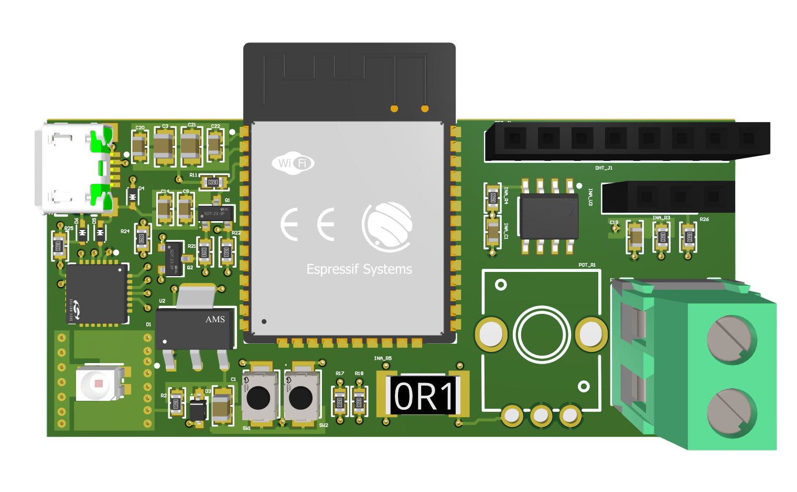

# Weather Monitor PCB

An ESP32 weather monitor with temperature, humidity, and solar power readings.

[Portfolio overview](https://felixchen2007.github.io/projects/weather-monitor/)

## Project details

- Contribution: Independent project
- Tools: Altium / ESP32 / Firmware
- Discipline: Embedded systems

## Documentation

A complete embedded system, developed one iteration at a time.

### From breadboard to board

I developed the monitor through three iterations: a breadboard prototype, a PCB built around an ESP32 development board, and a fully integrated custom PCB designed in Altium Designer. Each iteration brought more of the system onto one board.

### Making the sensors talk

I wrote firmware to read temperature and humidity from a DHT11 and monitor power using an INA219. Debugging involved checking I²C addresses, communications, and pin assignments so the sensors and controller could work together.

### Turning measurements into information

A 240 × 240 ST7789 TFT display and a custom webpage present the measurements. The project connects hardware design, firmware, and a usable interface in a single system.

### Design focus

- ESP32 microcontroller
- Temperature & humidity sensing
- Solar power monitoring
- Display + web interface

## Repository contents

This repository currently contains portfolio notes and a project image. Design files, source code, and test results can be added as the documentation develops.
